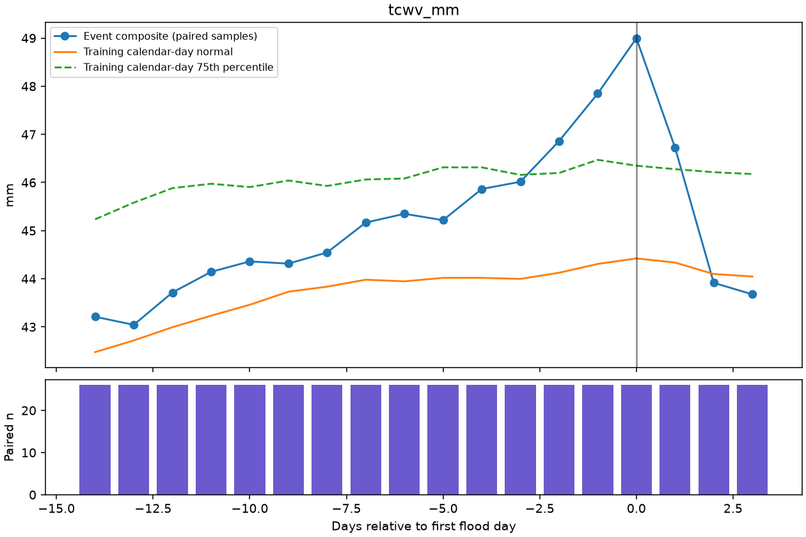
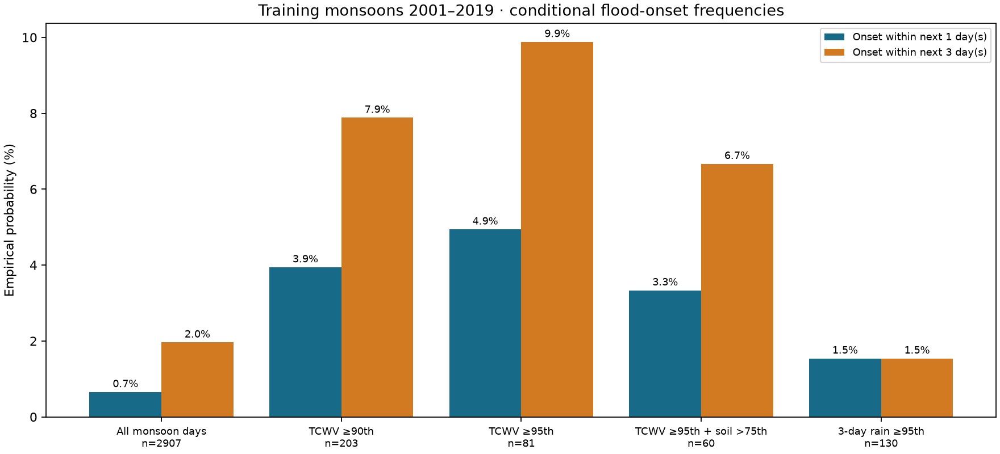
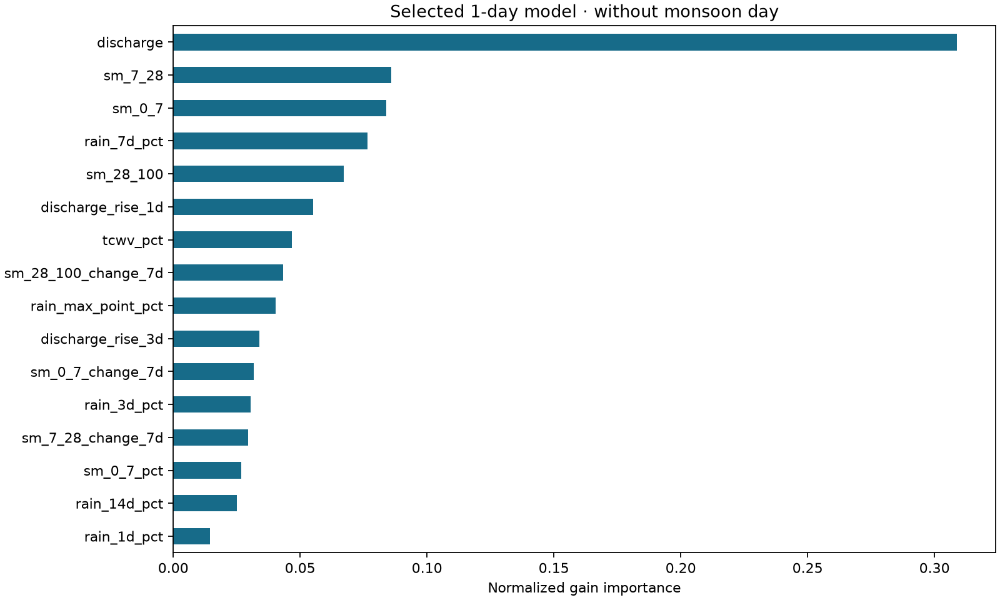
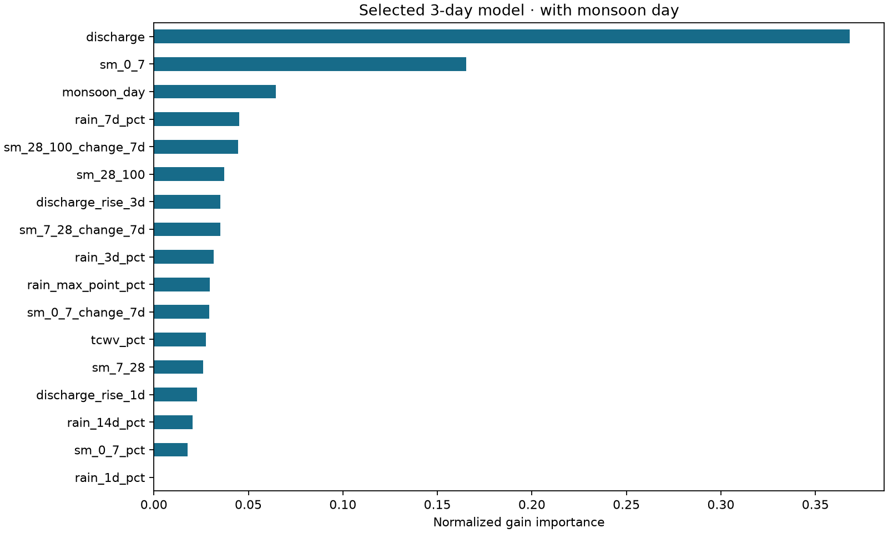
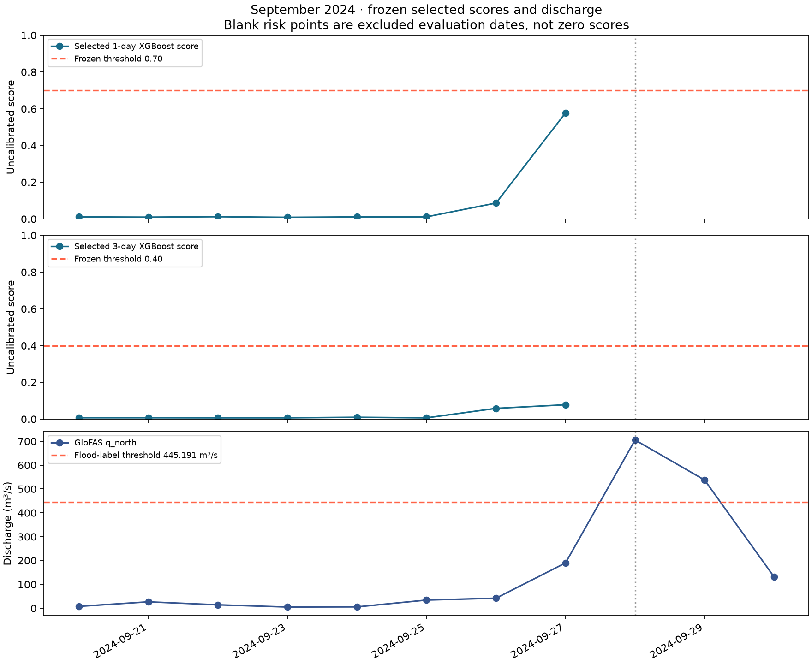
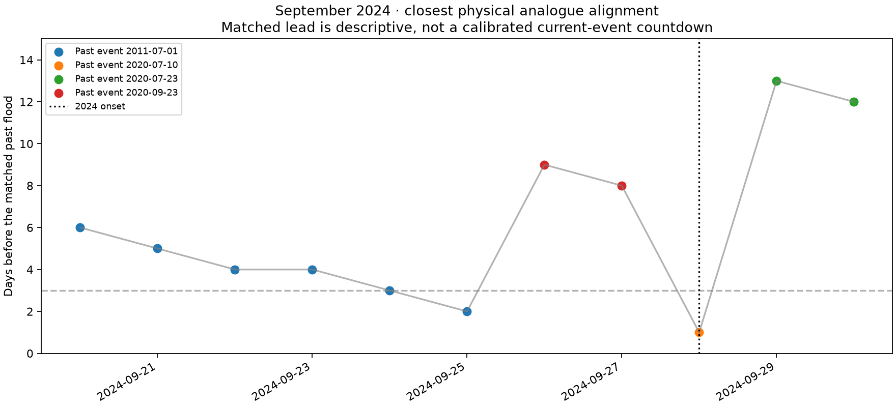
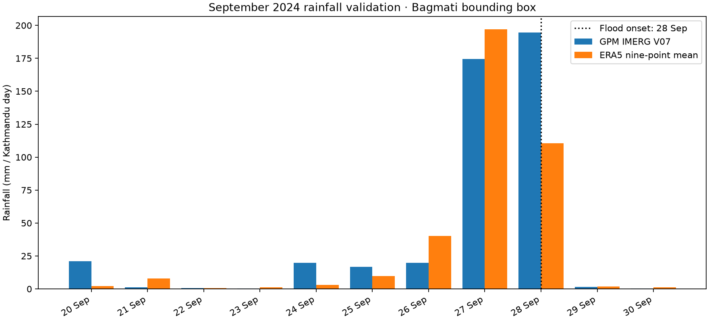

# Bagmati flood precursor project — demo results

Models are FROZEN. This pack reads saved models, predictions and selection records. It does not fit, retune, change feature sets, thresholds or selected variants.

## Event catalogue

26 GloFAS-proxy events: 19 training events (2001–2019), six main-test events, and the separately reported September 2024 event. Flood means q_north exceeds the training-monsoon 99th percentile, 445.191 m³/s. Onset is the first flood day; peak is the maximum discharge date.

| Event | Onset | Peak |
| --- | --- | --- |
| 1 | 2001-08-23 | 2001-08-23 |
| 2 | 2002-07-21 | 2002-07-22 |
| 3 | 2003-06-30 | 2003-06-30 |
| 4 | 2003-07-08 | 2003-07-08 |
| 5 | 2003-08-18 | 2003-08-18 |
| 6 | 2005-07-16 | 2005-07-16 |
| 7 | 2007-07-20 | 2007-07-26 |
| 8 | 2009-07-29 | 2009-07-29 |
| 9 | 2009-08-18 | 2009-08-19 |
| 10 | 2010-07-11 | 2010-07-11 |
| 11 | 2011-07-01 | 2011-07-01 |
| 12 | 2012-06-24 | 2012-06-24 |
| 13 | 2012-07-19 | 2012-07-19 |
| 14 | 2014-06-30 | 2014-06-30 |
| 15 | 2014-08-14 | 2014-08-14 |
| 16 | 2017-08-11 | 2017-08-12 |
| 17 | 2018-07-02 | 2018-07-02 |
| 18 | 2018-08-24 | 2018-08-24 |
| 19 | 2019-07-12 | 2019-07-12 |
| 20 | 2020-07-10 | 2020-07-10 |
| 21 | 2020-07-23 | 2020-07-23 |
| 22 | 2020-09-23 | 2020-09-23 |
| 23 | 2021-07-01 | 2021-07-01 |
| 24 | 2021-07-17 | 2021-07-17 |
| 25 | 2021-08-14 | 2021-08-14 |
| 26 | 2024-09-28 | 2024-09-28 |

## Stage 2: TCWV precursor finding

The all-event TCWV composite first exceeds the same-calendar-day training 75th percentile at lag -2 (2 days before onset), with 26 paired events. This includes test/case events and is exploratory, not a validated two-day forecast lead. Composites skip missing observations and report sample counts.





Conditional probabilities use 2001–2019 only. Denominators are condition-day counts, not independent events; both all-days and non-ongoing-flood populations are retained in conditional_probabilities.csv.

## Stage 3: validation-only calendar ablation

The ablation was prompted by the September 2024 diagnosis. Thresholds were tuned on pooled out-of-fold predictions from the existing three chronological validation folds inside 2001–2019. Selection uses mean fold F1; an exact tie drops monsoon_day. Neither test metrics nor September case results selected the variant. Existing targets, split purges, native NaN handling and exclusion of ongoing flood days remain in force.

| Horizon (days) | Feature set | Fold F1 values | Mean validation F1 | Threshold | Selection |
| --- | --- | --- | --- | --- | --- |
| 1 | with monsoon day | 0.0000, 0.2857, 0.0000 | 0.0952 | 0.90 | Not selected |
| 1 | without monsoon day | 0.1429, 0.1538, 0.0000 | 0.0989 | 0.70 | SELECTED |
| 3 | with monsoon day | 0.1782, 0.0619, 0.1163 | 0.1188 | 0.40 | SELECTED |
| 3 | without monsoon day | 0.1818, 0.0500, 0.0492 | 0.0937 | 0.50 | Not selected |

### Main test: 2020–2025, September 2024 reported separately

| Horizon | Variant | Status | Recall | Precision | FAR | F1 | Events detected | Mean lead (days) |
| --- | --- | --- | --- | --- | --- | --- | --- | --- |
| 1 | with monsoon day | Not selected | 50.0% | 17.6% | 1.60% | 0.261 | 3/6 | 1.00 |
| 1 | without monsoon day | SELECTED | 50.0% | 8.3% | 3.78% | 0.143 | 3/6 | 1.00 |
| 3 | with monsoon day | SELECTED | 66.7% | 6.1% | 21.51% | 0.112 | 5/6 | 2.80 |
| 3 | without monsoon day | Not selected | 50.0% | 6.1% | 16.05% | 0.109 | 4/6 | 2.75 |

Daily false alarm rate = FP/(FP+TN). Mean lead averages detected events only. There are 880 eligible one-day test dates and 878 three-day test dates; each has six evaluable events.

### Separate September 2024 results

| Horizon | Variant | Status | Recall | Precision | FAR | F1 | Events detected | Mean lead (days) |
| --- | --- | --- | --- | --- | --- | --- | --- | --- |
| 1 | with monsoon day | Not selected | 0.0% | 0.0% | 0.00% | 0.000 | 0/1 | — |
| 1 | without monsoon day | SELECTED | 0.0% | 0.0% | 0.00% | 0.000 | 0/1 | — |
| 3 | with monsoon day | SELECTED | 0.0% | 0.0% | 0.00% | 0.000 | 0/1 | — |
| 3 | without monsoon day | Not selected | 33.3% | 33.3% | 8.33% | 0.333 | 1/1 | 1.00 |

Both selected models miss September 2024. The non-selected three-day model without monsoon_day detects it one day ahead with two false alarms in 27 eligible case dates; this did not change the selected model.





## September 20–28 replay: frozen selected scores and closest analogue

| Date | 1-day score | Threshold | 3-day score | Threshold | Past event onset | Matched lead (days) |
| --- | --- | --- | --- | --- | --- | --- |
| 2024-09-20 | 0.011119 | 0.70 | 0.007322 | 0.40 | 2011-07-01 | 6 |
| 2024-09-21 | 0.009893 | 0.70 | 0.007290 | 0.40 | 2011-07-01 | 5 |
| 2024-09-22 | 0.012100 | 0.70 | 0.006899 | 0.40 | 2011-07-01 | 4 |
| 2024-09-23 | 0.008915 | 0.70 | 0.006899 | 0.40 | 2011-07-01 | 4 |
| 2024-09-24 | 0.011119 | 0.70 | 0.009949 | 0.40 | 2011-07-01 | 3 |
| 2024-09-25 | 0.011519 | 0.70 | 0.006785 | 0.40 | 2011-07-01 | 2 |
| 2024-09-26 | 0.086647 | 0.70 | 0.058434 | 0.40 | 2020-09-23 | 9 |
| 2024-09-27 | 0.577717 | 0.70 | 0.078245 | 0.40 | 2020-09-23 | 8 |
| 2024-09-28 | Excluded: ongoing flood | 0.70 | Excluded: ongoing flood | 0.40 | 2020-07-10 | 1 |



## Stage 4: physical analogue selection

Inputs: TCWV percentile; 1/3/7-day rainfall percentiles; topsoil moisture; one-day discharge rise. No calendar feature. Euclidean matching only; no DTW. Leave-one-event-out uses 19 training events, queried at onset-1 and onset-2. A hit means the top analogue ends within three days of its own event onset.

| Window (days) | Hits / queries | Hit rate |
| --- | --- | --- |
| 14 | 12/38 | 31.6% |
| 7 | 9/38 | 23.7% |

The 14-day configuration is selected. September uses pre-2024 event templates only. The 38 queries are paired observations from 19 events, not 38 independent floods.



## Satellite rainfall validation

NASA/GPM_L3/IMERG_V07 precipitation from read-only Earth Engine project bdasem-7; 3825 monsoon days, 2001–2025. Each Kathmandu day integrates the 49 overlapping half-hours with 15-minute weights at both day boundaries. Spatial support is the area-weighted nine-point bounding box at the native 0.1-degree grid.

Monsoon mean: IMERG 11.520 mm/day; ERA5 14.643 mm/day. Raw daily Pearson correlation 0.4941; seasonal-percentile correlation 0.4422. Each source has its own 2001–2019 reference. 31 dates contain non-permanent source intervals.

IMERG is validation only and is absent from model features and dashboard scoring. The 26-event before-onset rainfall percentile table is in satellite_event_rainfall_percentiles.csv.



## Known data limitations

- ERA5 rainfall has a previously noted local wet bias. The IMERG bounding-box mean and ERA5 nine-point mean have different spatial support, so their difference is not a controlled bias estimate. Neither is local rain-gauge truth.

- TCWV source gap: all nine points have 4,368 null hours from 2024-01-01 05:00 to 2024-07-01 04:00 in returned API local timestamps. Complete-day aggregation leaves 183 NaN days, including 31 monsoon dates (June plus July 1). There is no filling, interpolation or model substitution; XGBoost uses native NaN handling.

- GloFAS discharge labels are modelled proxies rather than observed DHM danger-level exceedances. GloFAS reanalysis and the weather inputs share ERA5 forcing; agreement between rainfall and these labels is not fully independent validation. See the [Copernicus GloFAS FAQ](https://confluence.ecmwf.int/spaces/CEMS/pages/315563119/6+FAQ+in+GloFAS).

- The main test has only six independent flood events; the September case is separate. Rare-event precision is low, especially for the three-day target. Daily positive-date counts differ from event counts.

- Approximate 1.5-day basin response is a user-supplied working estimate, not calibrated here. Daily means can obscure fast flood build-up, and end-of-day predictors do not establish a guaranteed operational warning lead.

- ERA5 is delayed reanalysis. This is a historical replay, with no live forecast equivalence, pollers or operational latency validation. Risk scores are class-weighted and uncalibrated, not flood probabilities.

- The TCWV lag-2 finding uses all-event exploratory composites. The calendar ablation was prompted after inspecting September; training-fold selection prevents direct test tuning but does not create a new blind confirmation set.

- Seasonal percentile references use only 2001–2019 monsoon observations. Three-day satellite comparisons omit the first two June reference days for both sources because satellite retrieval is monsoon-only.

- IMERG is a coarse (~0.1-degree) satellite-derived product that can include gauge calibration, retrieval errors and provisional records. Small mountainous basins have few pixels; satellite rainfall is not ground truth. The requested nine-point bounding box is a study-area rectangle, not a delineated catchment polygon. See the [official IMERG V07 catalogue](https://developers.google.com/earth-engine/datasets/catalog/NASA_GPM_L3_IMERG_V07).

- ONI uses a publication-lag approximation; historical values can be revised. ONI is excluded from the selected primary models and remains only in the earlier optional ablation.

- Closest analogue lead is descriptive and can jump when the nearest past event changes; LOEO hit rate is 12/38, not evidence of a reliable countdown to the current flood.

## Dashboard launch

Run from the project folder; the existing environment is ready. Do not run model training or calibration commands for the demo.

```sh
cd '/Users/sagarp/Documents/BDA_SEM 7'
venv/bin/streamlit run app.py
```

The date slider replays September 1–30. Rainfall, TCWV percentile, soil moisture, discharge, selected frozen scores/thresholds and closest past event are displayed. Current-flood and target-censored dates remain unscored.

Frozen-artifact verification: 80 recorded files matched before and after pack creation.
